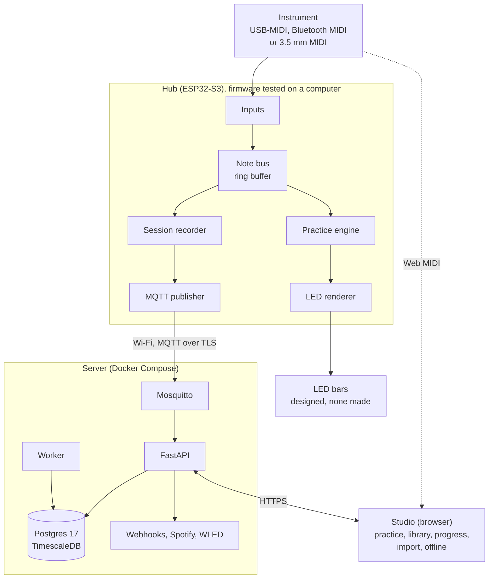
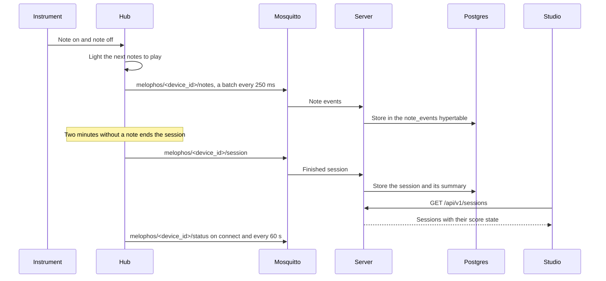

# Architecture

This page describes the parts of MELOPHOS as they are built today and how they fit together. Nothing here has run on real hardware and no board has been made, so every statement about the hub is about firmware tested on a computer. [What exists today](#what-exists-today) gives the status of each part in the words the [roadmap](roadmap.md) uses. A part that is designed and not built says so.

## The pieces

## A practice session

The topics and payloads are defined in [protocol.md](protocol.md). A new hub waits to be claimed: its owner types the code the hub shows and the hub's broker password is derived from its secret and never sent. Nothing in this walkthrough has run with a real hub. The Studio's request to the server has run only against a fake server in the Studio's tests.

## Hub

The hub is designed around an ESP32-S3 because it is a widely available chip that combines a USB host port (to read and power a keyboard), Bluetooth LE (for Bluetooth MIDI) and Wi-Fi (for the server). The firmware is built for that chip and for the development machine. Every feature is tested on the development machine only.

- **Inputs** each run independently and push note events onto one lock-free ring buffer, so a slow input never blocks the lights. The 3.5 mm MIDI jack, the USB-MIDI host and Bluetooth MIDI are written. Audio input has pins reserved and no firmware that reads it.
- **The practice engine** decides what each LED shows: played notes, the guide for the next notes, upcoming notes and wrong notes. It has the Melody, Rhythm and Listen modes.
- **The LED renderer** maps notes to LEDs through the instrument profile and drives WS2812B LEDs with FastLED. One constant caps the current drawn by the lights. The colours are the adopted table: amber for the next note and the right hand, blue for the left hand and rose-magenta for a wrong note.
- **The session recorder** groups notes into sessions. A session starts on the first note and ends after two minutes of silence. The publisher sends the notes in batches and the finished session over MQTT with TLS.
- **Updates and pairing.** The firmware checks signed updates and pairs with a code, as [protocol.md](protocol.md) describes.

## Server

- **FastAPI** exposes the HTTP API: accounts, hub pairing, sessions, songs, integrations and webhooks. There is no WebSocket and no push channel. A client asks for what it wants.
- **Postgres with TimescaleDB** stores sessions and every note event, in recorded migrations. Note events live in a hypertable because a single session can produce thousands of rows.
- **Mosquitto** receives hub traffic on `melophos/<device_id>/<kind>` topics. The broker lets a hub publish only under its own id.
- **The worker** reads its queues from the database and has no other service behind it. It delivers webhooks, scores sessions with the engine, reads uploaded MIDI files and tidies old rows.
- **Integration modules** for Spotify linking and WLED exist and stay off until configured. Signed webhooks for finished sessions are built. Audio import and video import are not built and Home Assistant is only a description.
- **Prometheus and Grafana** are an optional monitoring profile.
- **Deployment.** Every image in the compose file is pinned by digest. A release installs published images with an installer script. Until a release exists the stack is built on the machine. Backup and restore scripts are in the deploy folder. None of this has run on a home server of a player yet.

## Studio

A static TypeScript app that runs in the browser. It connects to a keyboard through Web MIDI and does not use Web Bluetooth. It needs no server and no account. It scores in the browser with the WebAssembly build of the scoring engine. It keeps sessions, imported pieces and settings in the browser, installs from a manifest and works offline through a service worker. It can import a MIDI file and let the player correct the split into hands.

A player can link the Studio to a server they run. It can then pair a hub by code, send an imported piece with its hands, read sessions and delete data on the server. The screens that control a hub, fit the lights and install firmware are not built.

## Shared pieces

- **The scoring engine** in `core/` is one Rust crate compiled to WebAssembly for the Studio and to a Python module for the server, so a performance gets the same score in both places. [scoring.md](scoring.md) states its model and its limits. Every figure on that page comes from synthetic performances.
- **Instrument profiles** in `profiles/` are read by every component, so a note maps to the same LED everywhere.
- **The protocol** in [protocol.md](protocol.md) is the contract between the hub, the server and the Studio.

The reasoning behind each choice is recorded in [decisions.md](decisions.md).

## What exists today

| Component | Status | Built so far | Still to come |
| --- | --- | --- | --- |
| Hub firmware | Host-tested, awaits a board | Three inputs (3.5 mm MIDI, USB-MIDI host and Bluetooth MIDI), the note bus, the practice modes, the LED renderer with its current cap, profiles in flash, session capture, MQTT publishing, pairing and signed updates | Audio input. A board to run it on |
| Hub board | In design | The requirements, a draft bill of materials and the power budget | The board layout and a manufactured board |
| LED bars | In design | The requirements for the octave bar | The design files and a made bar |
| Server | Built | Accounts, hub pairing, sessions and note events in Postgres, the MQTT subscriber, the song library with a MIDI reader, signed webhooks and the worker | Audio and video import, a finished Spotify list, room lights and Home Assistant |
| Scoring engine | In progress | `score` and `follow` in Rust with a WebAssembly build and a Python module. The follower treats each hand as its own line with one shared tempo and has a not judged verdict for a press it cannot place | Fixing the limits listed in [scoring.md](scoring.md). Real players: not yet checked |
| Studio | Partly built | Practice, progress, a library, MIDI import, hand correction, settings, offline use, install and the optional link to a server | Screens for the hub. A check against a real server. A check by a person who uses a screen reader: not yet checked |
| Client | Built | A Python client and a hub simulator | |

The [roadmap](roadmap.md) lists the order the rest arrives in.
