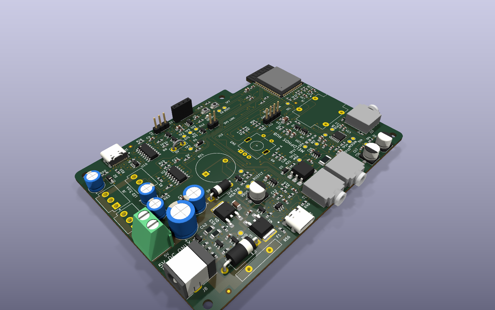
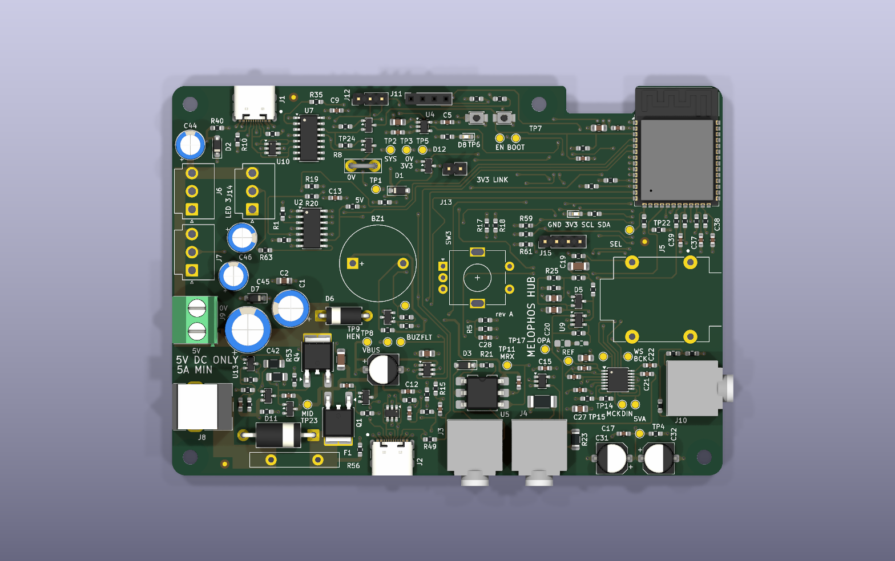
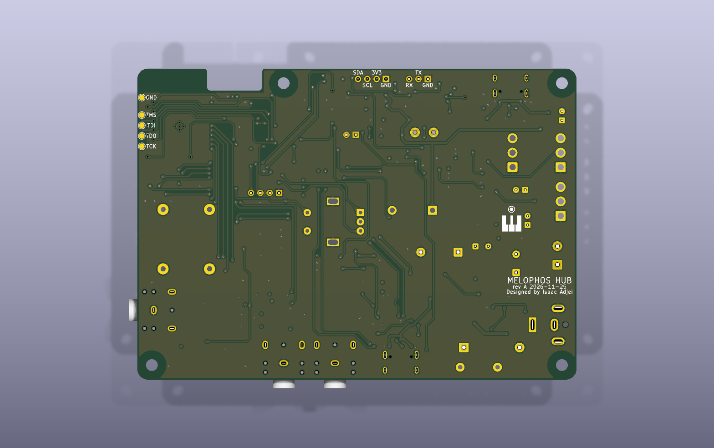
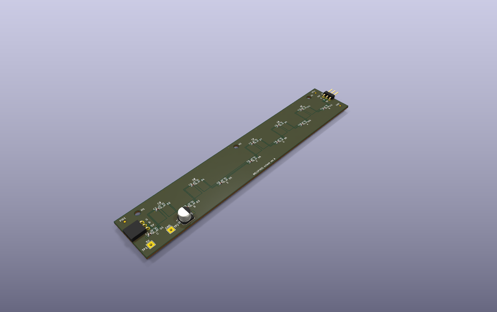
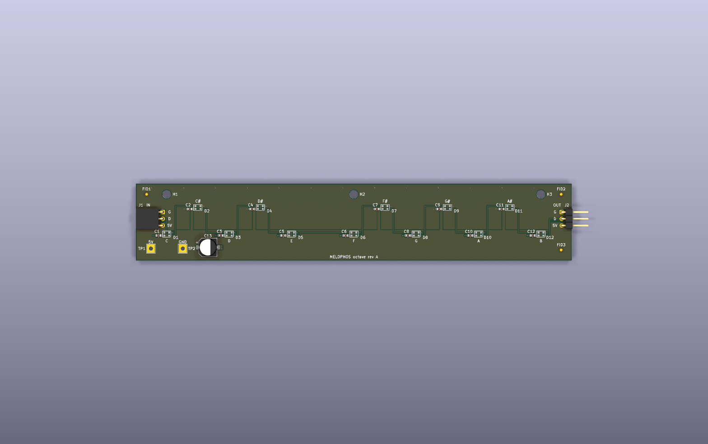
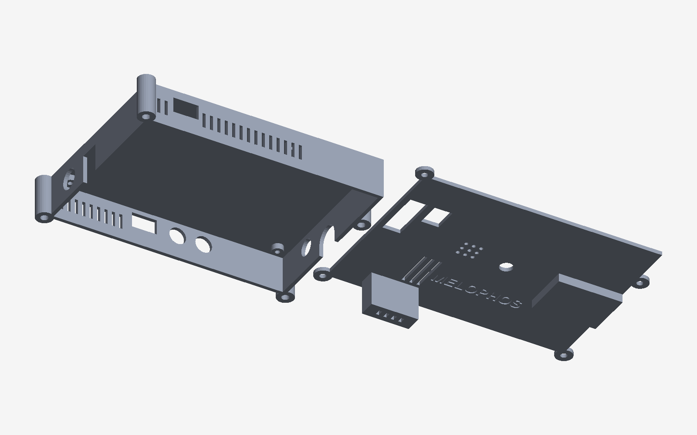
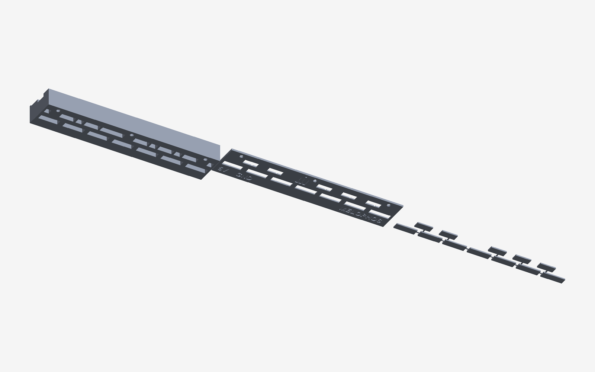

# MELOPHOS hardware

The MELOPHOS hub and its light bars, designed in KiCad, with 3D-printable parts to hold them.

> [!IMPORTANT]
> Every board is fully designed and waiting to be manufactured. None has been built or tested yet. The pictures here are renders of the finished designs. We publish the KiCad files, the Gerbers and the full bill of materials once the boards have been made and tested.

> [!NOTE]
> This is a read-only copy published from [melophos/melophos](https://github.com/melophos/melophos). Open issues and pull requests there.

| Folder | What it is | Status |
| --- | --- | --- |
| [`hub/`](hub/) | The hub: ESP32-S3, 5 V inlet, USB host port, three LED outputs, MIDI jacks and audio input | Rev A designed, waiting to be made |
| [`keys-octave/`](keys-octave/) | Light bars: the octave bar and four end bars for 61, 76 and 88 keys | Rev A designed, waiting to be made |
| [`enclosures/`](enclosures/) | 3D-printable hub case, bar clips and diffusers | Designed, not yet printed |
| [`frets/`](frets/) | Fret bar: one LED per string per fret for guitars | Planned for v3 |
| [`bom/`](bom/) | Bills of materials | Draft, the final one ships with the design files |

## Where the design stands

- **Designed:** the hub and all five light bars are drawn and laid out in KiCad 10. Every schematic passes the electrical rules check and every board passes the design rules check.
- **Simulated:** the hub's power input was simulated in LTspice before ordering, across supply swaps, plug-in surges and reversed supplies. The simulations found two faults that the rule checks had passed. Both were fixed and checked again.
- **Next:** the boards are made, then brought up stage by stage on the bench. The firmware is already written and host tested, so it runs as soon as a board exists.

## Pictures

| | |
| --- | --- |
|  |  |
| Hub, top | Hub, underside |
|  |  |
| Octave bar | Octave bar, top |
|  |  |
| Hub case | Octave diffuser |

More views of each part are in [hub/](hub/), [keys-octave/](keys-octave/) and [enclosures/](enclosures/).

## Power budget

The firmware's current limits and the figures behind them are in [firmware/docs/pins-and-power.md](https://github.com/melophos/melophos/blob/main/firmware/docs/pins-and-power.md).

## Licence

CERN Open Hardware Licence Version 2, Strongly Reciprocal. See [LICENSE](LICENSE).
