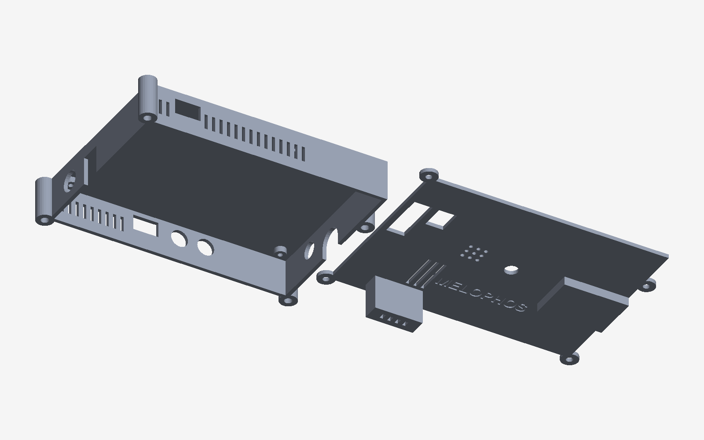
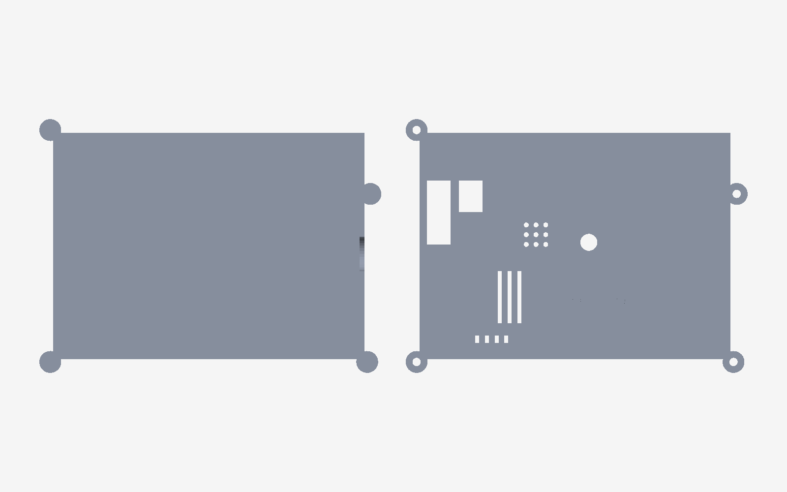
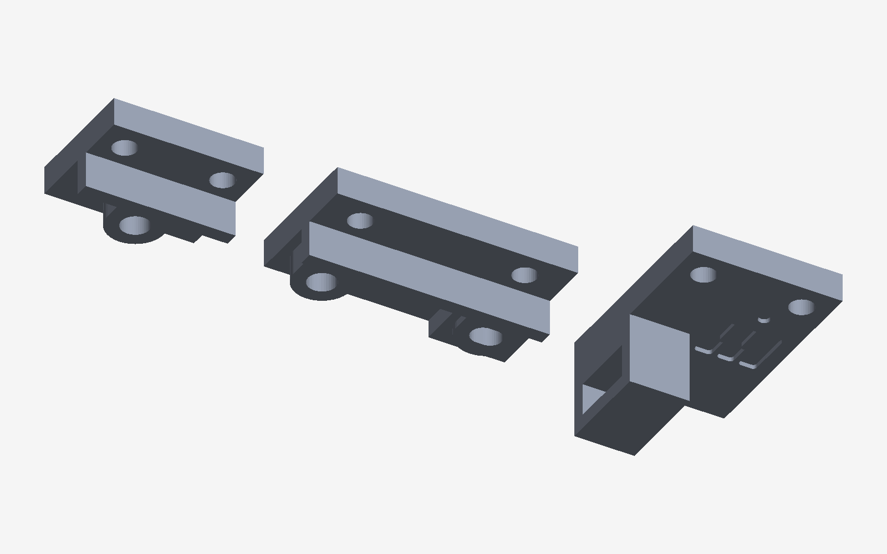
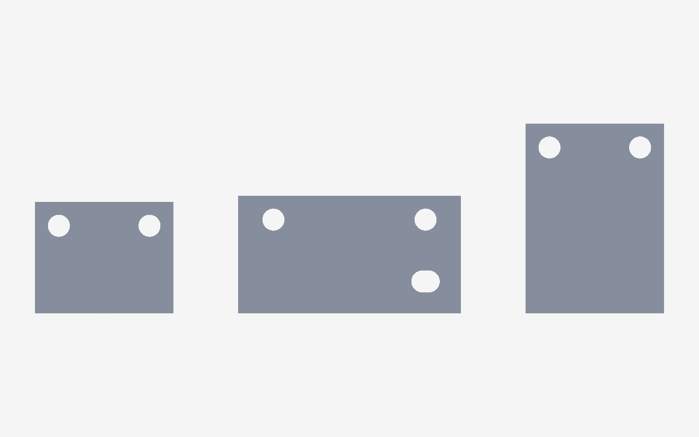
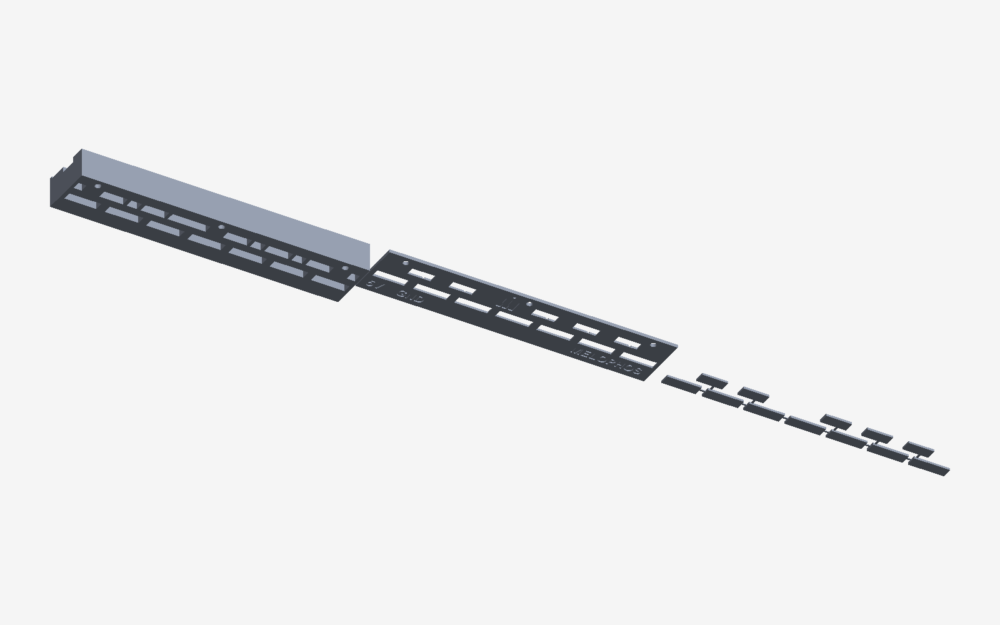
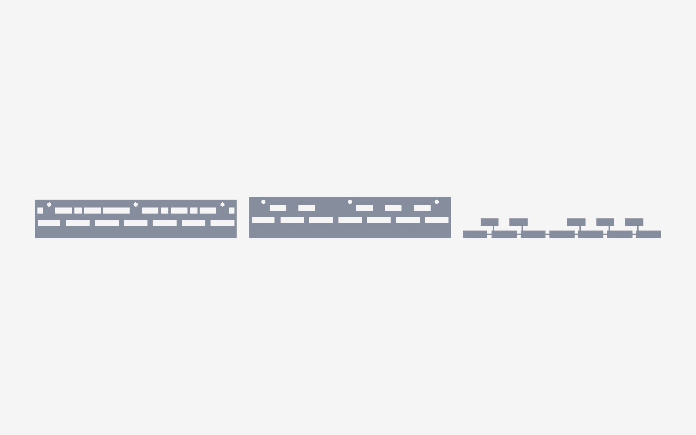

# Enclosures

3D-printable parts for the hub and the light bars.

> [!IMPORTANT]
> The parts are designed and sized from the board files. None has been printed yet. We publish the STEP and STL files once they have been printed and fitted to real boards.

| Part | Purpose | Status |
| --- | --- | --- |
| Hub case | Protects the hub board and exposes the jacks and ports | Designed, not printed |
| Bar clips | Hold the light bars on an aluminium channel behind the keys | Designed, not printed |
| Diffuser | Softens each LED into an even glow over its key | Designed, not printed |

The bar parts were checked for collisions against every light bar.

## Pictures

| | |
| --- | --- |
|  |  |
| Hub case | Hub case, top |
|  |  |
| Bar clips | Bar clips, top |
|  |  |
| Octave diffuser | Octave diffuser, top |
