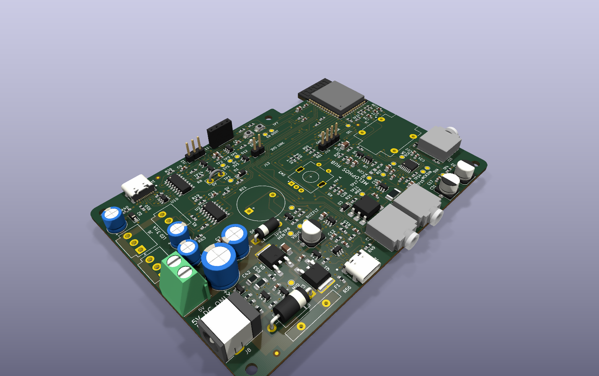
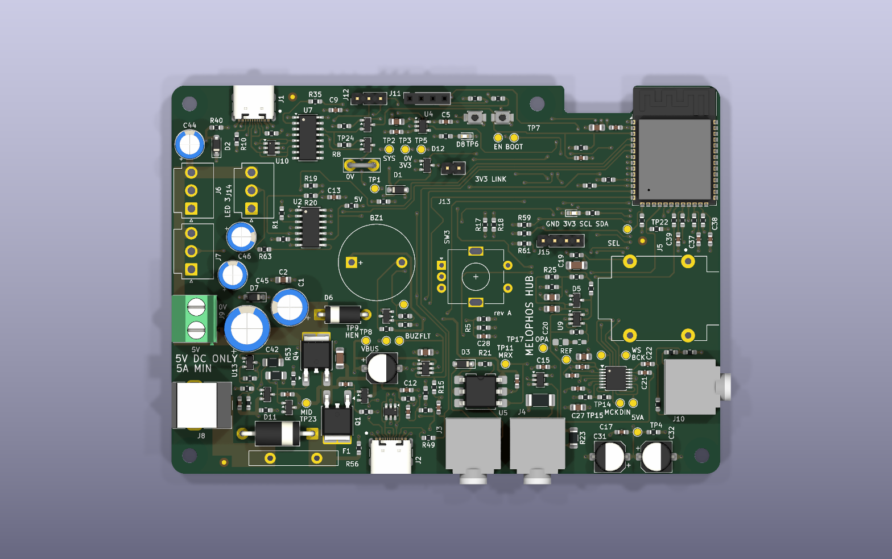
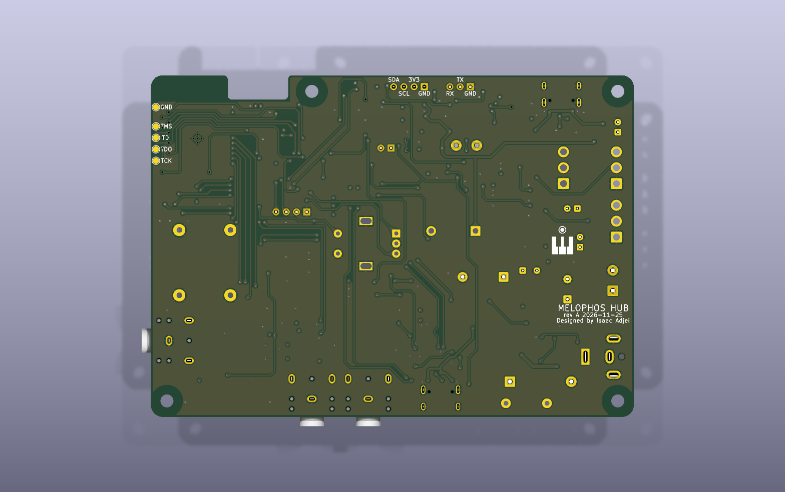

# Hub board

The hub reads notes from the instrument, drives the light bars and talks to the server.

> [!IMPORTANT]
> Rev A is fully designed and waiting to be manufactured. It has not been built or tested. We publish its KiCad files and Gerbers once boards have been made and tested.

## Rev A

- 120 mm by 85 mm on four layers
- ESP32-S3-WROOM-1 module (16 MB flash, 8 MB PSRAM) with its antenna clear of copper
- A 5 V DC jack that powers the LEDs, the host port and the audio input, with a resettable fuse, reverse blocking, an over-voltage lockout and a soft start
- USB-C in for programming, which powers the logic alone
- USB-C host port that powers the instrument through a current-limited switch (1 A)
- Three level-shifted LED outputs on locking connectors, each with a series resistor and bulk capacitance at the connector
- MIDI in through an optocoupler and MIDI out through a buffer, on 3.5 mm TRS type A jacks
- Instrument and line input into an I2S ADC
- Boot and reset buttons, a status LED, a rotary encoder with a push switch and a header for an optional display
- A passive piezo buzzer for a metronome click and a spare header with the module pins left over

> [!WARNING]
> The USB host port supplies power to the instrument. The power switch limits current and reports faults, so a short in a USB cable cannot brown out the whole hub.

> [!WARNING]
> The jack takes any 5.5 mm by 2.1 mm plug, so a 12 V or 24 V adapter fits it. The over-voltage lockout is there for that mistake. It passed in simulation and stays unproven until a board is built and tested.

## How it was checked

- The schematic passes the electrical rules check and the board passes the design rules check with nothing left unconnected.
- The power input was simulated in LTspice across 16 cases of lead length and capacitor resistance. That run found that a live swap from a 5 V to a 12 V supply could overstress one transistor and that the plug-in surge could reach 17.8 A. Both were fixed. The worst plug-in surge is now 4.62 A and the first LED on a bar never sees more than 5.045 V, under its 5.3 V limit.
- The firmware keeps every LED output off for 0.5 s after power-on, twice the longest time the simulation shows the 5 V switch needs to turn fully on.

## Pictures

| | |
| --- | --- |
|  |  |
| Top | Underside |

The draft bill of materials is [bom/hub-rev-a.csv](../bom/hub-rev-a.csv).
