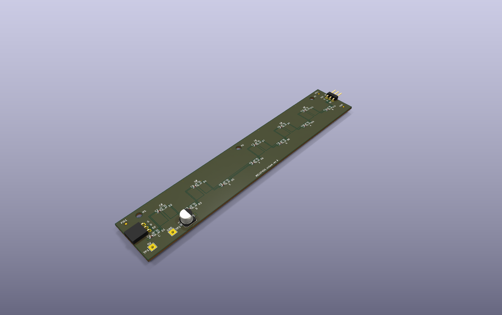
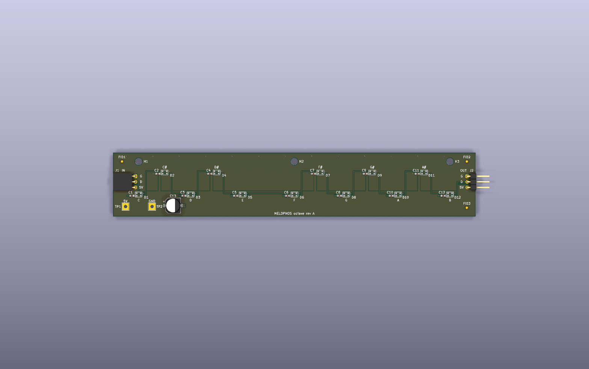
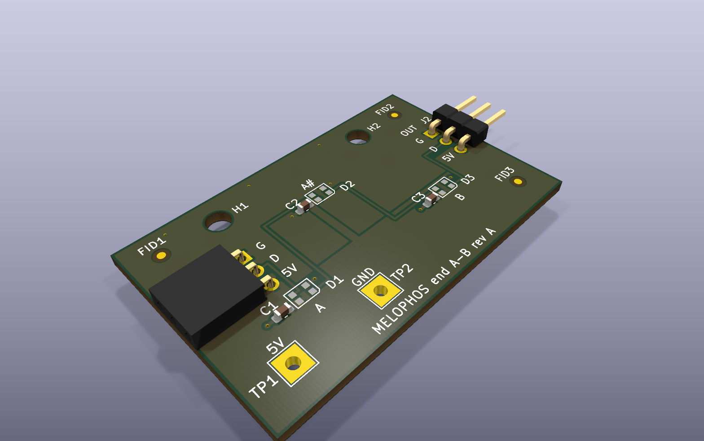
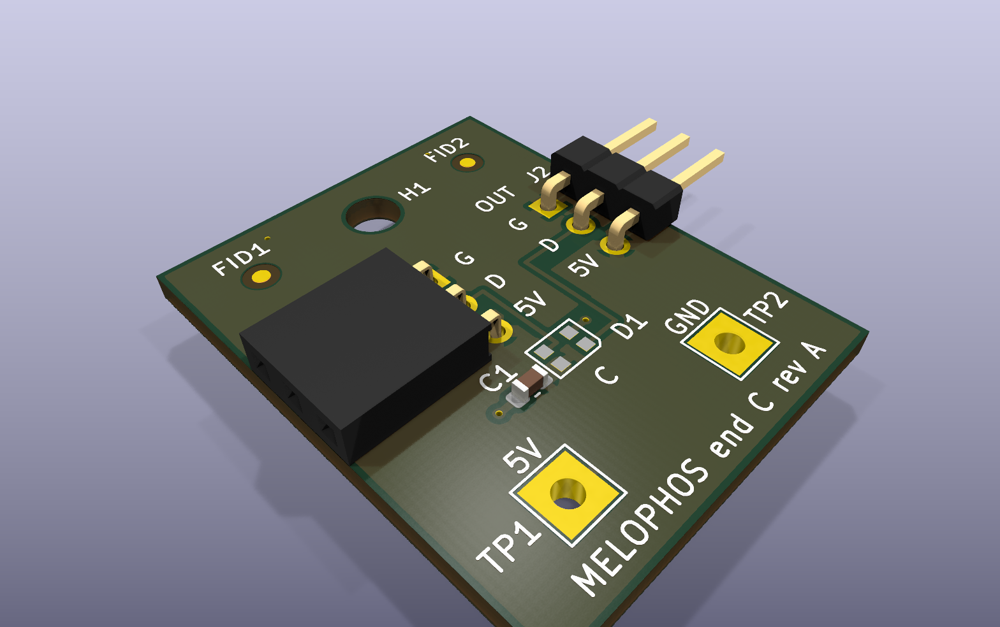
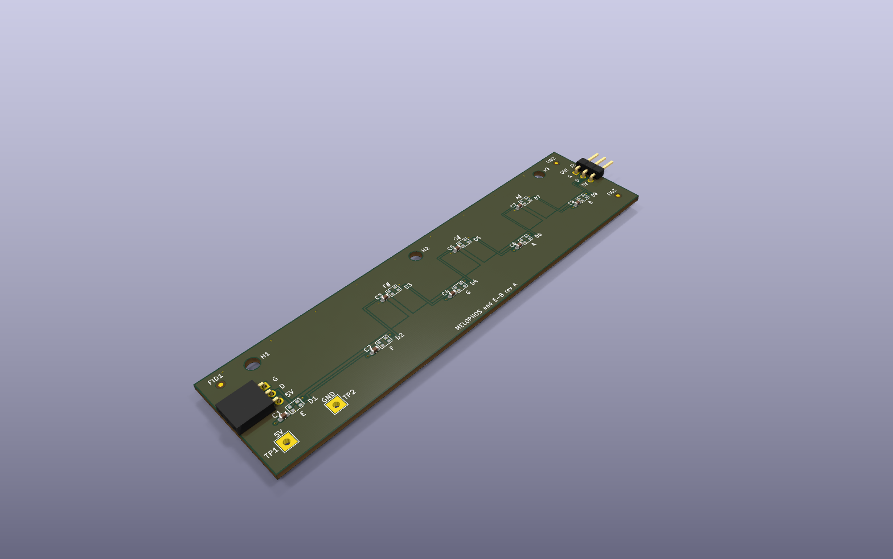
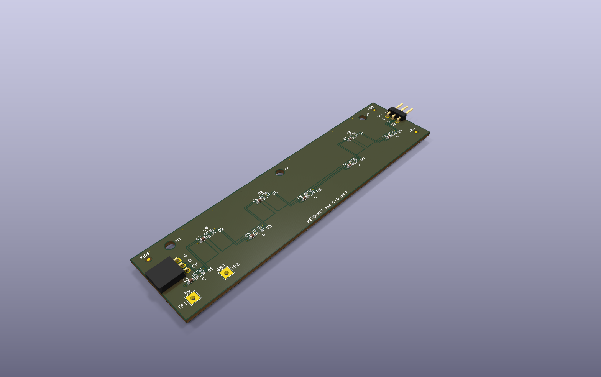

# Light bars

Strips of LEDs placed at real key positions, so every key on a keyboard gets exactly one LED with no drift along the keybed.

> [!IMPORTANT]
> All five boards are fully designed and waiting to be manufactured. None has been built or tested. We publish their KiCad files and Gerbers once boards have been made and tested.

## Rev A

- WS2812B-2020 LEDs: white keys on one line and black keys set back on a second line
- Pitch from a standard white key width of 23.5 mm
- Data in, data out and 5 V power on edge connectors, so bars daisy-chain end to end
- Two layers on 1.6 mm board, all five sharing one set of dimensions so the key grid carries from one board to the next

| Board | Keys | LEDs | Size | Used on |
| --- | --- | --- | --- | --- |
| Octave | C to B | 12 | 164.2 mm by 29 mm | Every full octave |
| End A to B | A, A sharp, B | 3 | 46.7 mm by 29 mm | Low end of 88 keys |
| End C | C | 1 | 23.2 mm by 29 mm | High end of 61 and 88 keys |
| End E to B | E to B | 8 | 117.2 mm by 29 mm | Low end of 76 keys |
| End C to G | C to G | 8 | 117.2 mm by 29 mm | High end of 76 keys |

The LED order along a bar is C, C sharp, D and so on up to B, matching the `per-key` layout in [profiles/](https://github.com/melophos/profiles).

## Pictures

| | |
| --- | --- |
|  |  |
| Octave bar, top | End A to B |
|  |  |
| End C | End E to B |
|  | |
| End C to G | |
